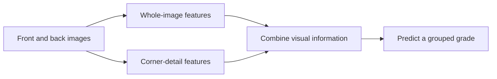

# Pokémon Card Grading
**Learning card condition from front-and-back images**

A computer vision research project investigating how whole-card appearance, local corner details, and training objectives affect automated card grading.

**Input:** a card's front and back images  
**Output:** one of six grouped grades — **≤5 · 6 · 7 · 8 · 9 · 10**  
**Focus:** local visual evidence, high-grade confusion, and controlled experiments

> This is the public project overview. The training implementation, model weights, detailed configurations, and internal experiment records are maintained privately.

## Why this problem?

Small differences in visible condition can make adjacent grades difficult to distinguish. A model needs to capture both the overall appearance of a card and fine details at its corners. Overall accuracy alone also leaves an important question unanswered: which grades are being confused, and in which direction?

This project studies those questions through a global baseline, a model with additional corner information, and controlled comparisons of training objectives.

## The approach at a glance

*High-level view of M1. M0 uses only the whole-image branch.*

| Model | What it sees | Research role |
|---|---|---|
| **M0 — Global baseline** | Overall appearance of the front and back | Establish a reference for paired-image grading |
| **M1 — Global + Local** | Both whole images and corner crops from each side | Investigate the contribution of local visual information |

Corner crops are defined relative to the input images. They are not automatic card-boundary detection, and their content depends on how the original photographs are framed.

## Research questions

1. **Do corner details help?**  
   Compare global-only and global-plus-local models, then examine what happens when local information is altered during evaluation.

2. **Which training objectives change high-grade errors?**  
   Investigate standard, class-weighted, and direction-sensitive objectives under controlled settings.

3. **Can overestimation be reduced without losing correct high-grade predictions?**  
   Examine confusion among grades 8, 9, and 10 alongside overall classification performance.

These questions guide the experiments; they are not claims that a particular model or loss has already proved superior.

## How comparisons are designed

- **Card-level splits:** front and back images of a card stay together, with fixed training, validation, and test partitions.
- **Repeated training seeds:** examine variation across runs instead of relying on one favorable result.
- **Controlled changes:** isolate architecture or training-objective changes while retaining the relevant comparison settings.
- **Validation-based selection:** use a consistent standard cross-entropy criterion for checkpoint selection; reserve the test split for final evaluation.
- **Error analysis:** consider accuracy, macro F1, balanced accuracy, per-grade recall, confusion matrices, and overestimation versus underestimation.
- **Clear denominators:** report a grade-specific error rate relative to the number of cards with that true grade.

## Engineering scope

The implementation uses **Python · PyTorch · BlueHive3 · Slurm · TensorBoard**.

The project brings together paired-image preprocessing, global and local visual modeling, configurable experiments, checkpointing and resume support, experiment tracking, and independent evaluation. Experiment identities and saved configurations support comparison across runs.

## Current status

**Ongoing research.** This repository describes the project's scope and methodology. Numerical benchmark results are not included in this public snapshot. Performance conclusions require the corresponding verified evaluation records.

The six output categories are grouped research labels. A prediction is not a professional grading certification. Image framing, visible background, class imbalance, and adjacent-grade ambiguity remain relevant limitations.

## Repository scope

This repository contains project documentation only. It does not provide an executable training or inference package, a hosted prediction service, or model downloads.
