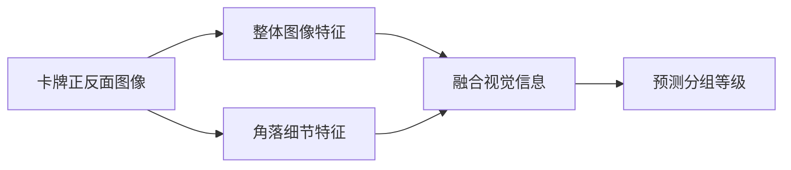

# Pokémon 卡牌品相分级
**从卡牌正反面图像学习整体品相与局部细节**

[English](README.md) · [作者](https://github.com/Fred-Li-123)

这是一个计算机视觉研究项目，关注整体图像、角落细节和训练目标如何影响卡牌等级预测。

**输入：** 同一张卡牌的正面与背面图像  
**输出：** 六个分组等级之一 — **≤5 · 6 · 7 · 8 · 9 · 10**  
**研究重点：** 局部视觉信息、高等级混淆与受控对照实验

> 本仓库用于公开介绍项目。训练实现、模型权重、完整配置与内部实验记录保留在私有环境中。

## 这个项目研究什么？

相邻等级之间的品相差异可能很细微。模型既需要理解整张卡牌的外观，也需要利用角落等局部区域的细节。仅看整体准确率，还无法知道模型具体混淆了哪些等级，以及错误更倾向于高估还是低估。

项目通过整体图像基线、加入角落信息的模型，以及训练目标的对照实验，研究这些问题。

## 方法概览

*上图为 M1 的高层流程。M0 只使用整体图像分支。*

| 模型 | 使用的视觉信息 | 研究作用 |
|---|---|---|
| **M0 — Global 基线** | 卡牌正面与背面的整体外观 | 建立双面图像分级的参考 |
| **M1 — Global + Local** | 正反面整体图像与两面的角落裁切 | 研究局部细节是否提供额外信息 |

角落裁切以输入图像边界为参照，不等于自动检测卡牌边界；实际裁到的内容受原始照片取景方式影响。

## 核心研究问题

1. **角落细节是否有帮助？**  
   比较仅使用整体图像与加入局部信息的模型，并分析评估时改变局部信息带来的影响。

2. **不同训练目标如何影响高等级误判？**  
   在受控条件下研究标准、类别加权和考虑错误方向的训练目标。

3. **减少高估是否会损失正确的高等级预测？**  
   同时分析 Grade 8、9、10 之间的混淆和整体分类表现。

这些问题用于指导实验，不代表某种模型或 Loss 已被证实更优。

## 如何设计对照实验？

- **按卡牌划分数据：** 同一卡牌的正反面保持配对，训练、验证和测试使用固定划分。
- **多个训练种子：** 观察不同运行之间的变化，避免只依据一次较好的结果下结论。
- **控制实验变量：** 比较架构或训练目标时，固定相关对照条件。
- **使用验证集选择：** 以一致的标准交叉熵选择 Checkpoint；测试集保留用于最终评估。
- **分析错误结构：** 同时关注准确率、Macro F1、Balanced Accuracy、逐等级 Recall、混淆矩阵以及高估和低估。
- **明确错误率分母：** 某个真实等级的错误率，以该真实等级的卡牌数量为分母。

## 工程工作

项目使用 **Python · PyTorch · BlueHive3 · Slurm · TensorBoard**。

实现范围涵盖双面图像预处理、整体与局部视觉建模、可配置实验、Checkpoint 与恢复训练支持、实验记录及独立评估。运行标识与保存的配置用于支持跨实验比较。

## 当前状态

**研究进行中。** 本仓库介绍项目范围与研究方法，当前公开版本不包含数值基准结果。性能结论需要对应的、经过核对的评估记录支持。

六个输出类别是研究使用的分组标签，模型预测不等于专业评级认证。照片取景、可见背景、类别不均衡和相邻等级的模糊性，都是分析中需要考虑的局限。

## 仓库范围

本仓库仅包含项目介绍文档，不提供可直接运行的训练或推理程序、在线预测服务或模型下载。

**作者：** [Fred-Li-123](https://github.com/Fred-Li-123)
